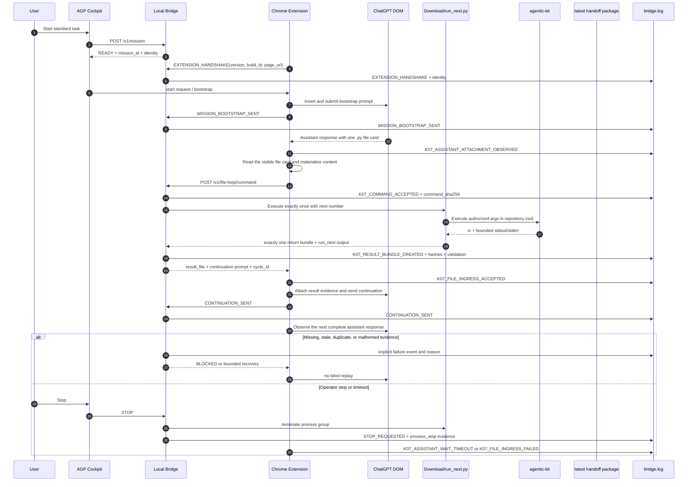

# AGP Cockpit Communication Sequence

This is the normative planning view for the normal LIVE/FULL_AUTO K07 file loop.
The sequence is intentionally explicit about the evidence that must exist before
the next remote turn is allowed.

## Acceptance Invariants

- The visible extension version and build identity match the staged extension.
- A Python file card is sufficient terminal evidence for the remote response; the
  loop does not wait for unrelated prose stability.
- `K07_COMMAND_ACCEPTED` precedes local execution and includes the command hash.
- `K07_RESULT_BUNDLE_CREATED` includes return-bundle and runner-output paths,
  hashes, byte validation, return status, and execution identity.
- The turn counter advances only after the bridge accepts the command-file result.
- `CONTINUATION_SENT` is emitted only after result evidence is attached.
- A timeout or stop leaves a structured diagnostic record and never becomes an
  uncaught browser promise rejection.
- Each diagnostic event carries application version, bridge build, extension
  version, extension build, mission id, conversation URL, run generation, and
  client turn where available.

## Failure Reading Guide

The first missing event identifies the boundary that failed:

| Last event | Interpretation |
| --- | --- |
| `MISSION_BOOTSTRAP_SENT` | ChatGPT did not yield an accepted new response or the DOM observer missed it. |
| `K07_ASSISTANT_ATTACHMENT_OBSERVED` | The file card was found, but fetch or bridge ingress failed. |
| `K07_COMMAND_ACCEPTED` | Local execution, `run_next.py`, or result validation failed. |
| `K07_RESULT_BUNDLE_CREATED` | Browser result transport or continuation submission failed. |
| `CONTINUATION_SENT` | The next remote response is the remaining boundary. |
| `K07_ASSISTANT_WAIT_TIMEOUT` | No new assistant response arrived before the bounded wait; the run is terminal and must not replay automatically. |
